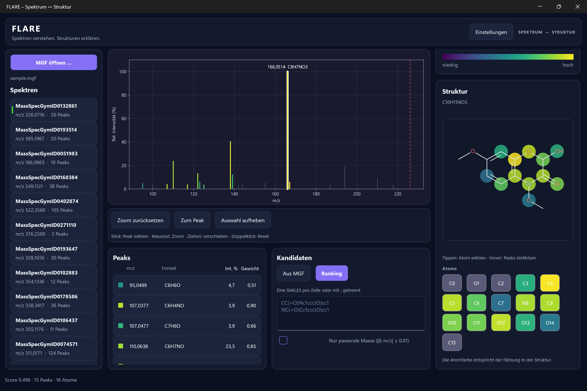

# FLARE.Net

A .NET implementation of the FLARE spectra–molecule matching pipeline, with a cross-platform .NET MAUI application, reusable inference services, and a command-line interface. It explains tandem mass spectra with molecular structures, peak-to-atom similarities, and candidate scores.

This repository contains the .NET application, its exported ONNX model, sample data, and numerical reference tests. It does not contain the original Python training pipeline, training datasets, or external chemistry-source checkouts.



## Features

- **Interactive spectrum exploration:** open MGF files, select spectra, inspect peaks, and zoom or pan the spectrum.
- **Structure explanation:** score a SMILES candidate against the selected spectrum and map peak-to-atom similarities onto the molecular structure.
- **Candidate ranking:** rank candidates from the MGF file or from manually entered SMILES; inspect scores, formulas, and precursor-mass differences.
- **Linked views:** peak selection, atom selection, highlighting, normalization, and color scales help explore model correspondences.
- **Desktop and phone layouts:** responsive MAUI views for Windows and Android, with touch-oriented phone navigation.
- **Configurable model:** choose and load an ONNX model in the app's settings without rebuilding.
- **Reusable .NET inference:** the ONNX and chemistry services can also be used outside the UI.

## Requirements

- .NET 10 SDK, with the .NET MAUI workload for Windows and Android application builds.
- Windows 10 version 1809 or later for the Windows app; Android API 24 or later for the Android app.
- Git and **Git LFS** to retrieve the ONNX model.
- An Android SDK, configured through the standard MAUI workload, for Android builds.
- NuGet.org access for package restore. **MolDraw.Net is consumed as NuGet packages** (`MolDraw.Core` and `MolDraw.Maui`); its repository is not a submodule and no local package feed is required.

The core inference libraries target .NET 8, while the MAUI projects target .NET 10. The Windows application uses RDKit for chemistry and molecular layout. Android uses the NCDK port. The Windows app is built for `win-x64` because the RDKit .NET package supplies native Windows x64 binaries.

## Clone and restore

Install [Git LFS](https://git-lfs.com/) before cloning, then run:

```sh
git lfs install
git clone https://github.com/Agredo/FLARE.Net.git
cd FLARE.Net
git lfs pull
dotnet restore Flare.slnx
```

Verify that `flare_onnx/flare.onnx` is a real ONNX file, not a small Git LFS pointer. The model is approximately 28 MB. The UI screenshot is stored as a regular Git file; only `flare_onnx/*.onnx` uses LFS.

## Run the Windows application

```sh
dotnet run --project src/Flare.Maui --framework net10.0-windows10.0.19041.0
```

On startup, the application looks for the model in this order:

1. A model saved through the app's settings.
2. The file specified by the `FLARE_ONNX` environment variable.
3. `flare.onnx` next to the executable. Windows builds automatically copy the repository model there when it exists.
4. `flare_onnx/flare.onnx` in a parent directory of the executable.

Open **Settings** to browse for a model, inspect its path and load status, load it explicitly, or restore the default model. The model must remain accessible at the selected path.

### Analyze a spectrum

1. Open an MGF file with **Open MGF**, or use `samples/sample.mgf`.
2. Select a spectrum and a SMILES candidate. Metadata in the MGF supplies formula, adduct, precursor, and candidate information when available.
3. Run the analysis or rank candidates. The score measures compatibility between one spectrum and each candidate; it is not a probability.
4. Explore the spectrum, peak table, structure, atom highlighting, and candidate results. Change normalization or the highlight threshold to focus on stronger correspondences.

## Android build and signing

Build a release APK with:

```powershell
.\build-apk.ps1
```

For a signed APK, provide a keystore outside source control using these environment variables:

```text
FLARE_ANDROID_KEYSTORE
FLARE_ANDROID_KEY_ALIAS
FLARE_ANDROID_STORE_PASS
FLARE_ANDROID_KEY_PASS
```

Without signing variables, the script creates an unsigned release APK. Keystores, passwords, credential files, and generated APKs are excluded from Git. APKs are build artifacts; download or transfer them separately rather than expecting them in a source checkout.

The Android UI lets you select an ONNX model through the device file picker. Unlike Windows, the current Android build does not embed the repository model in the APK.

## Command-line interface

Rank annotated spectra against all distinct SMILES in the included MGF sample:

```sh
dotnet run --project src/Flare.Cli -- eval-mgf --model flare_onnx/flare.onnx --mgf samples/sample.mgf
```

Rank explicitly supplied candidates against a text spectrum containing one `m/z intensity` pair per line:

```sh
dotnet run --project src/Flare.Cli -- --model flare_onnx/flare.onnx --spectrum spectrum.txt --formula C9H10O2 --adduct "[M+H]+" --precursor-mz 151.0754 --smiles "CC(=O)Oc1ccccc1C(=O)O" --smiles "CCOC(=O)c1ccccc1O" --json
```

Use `--candidates smiles.txt` for a file with one SMILES per line, `--top 20` to limit results, and `--parent-mass` when the neutral parent mass is known. Numeric text-spectrum and CLI inputs use invariant-culture decimal notation.

## ONNX model interface

The complete model and tensor specification is in [flare_onnx/ONNX_MODEL.md](flare_onnx/ONNX_MODEL.md). In brief, one inference call compares **one spectrum** with a batch of `B` candidate structures. All tensors are `float32`.

| Direction | Name | Shape | Meaning |
|---|---|---|---|
| Input | `spec` | `[P, 15]` | Normalized elemental subformula counts and transformed intensity for each annotated peak |
| Input | `atoms` | `[B, N, 78]` | RDKit-compatible atom features, padded to the largest candidate |
| Input | `adj` | `[B, N, N]` | Molecular adjacency matrices, including self-loops |
| Input | `atom_mask` | `[B, N]` | Real atoms versus padding |
| Output | `scores` | `[B]` | One FILIP compatibility score per candidate; rank descending |
| Output | `similarity` | `[B, P, N]` | Cosine similarity between peak and atom embeddings |

`P` is the number of retained, formula-annotated peaks and `N` is the maximum heavy-atom count in the candidate batch. Candidates are evaluated in chunks of 64 by the C# implementation.

Preprocessing merges peaks, filters and normalizes intensities, assigns chemically valid subformulas, adds the precursor representation, and constructs atom features and molecular graphs outside ONNX. The model outputs fine-grained similarities; it does **not** generate structures, SMILES, or spectra. A higher score indicates a better relative match within the same spectrum.

### Why ONNX

ONNX Runtime executes the graph without Python, PyTorch, Lightning, or DGL, so the same ~28 MB artifact can run in the Windows and Android apps and in any other ONNX Runtime host. The graph contains only standard ONNX operators and exposes a small contract of four `float32` inputs and two `float32` outputs with dynamic peak, batch, and atom dimensions. Chemistry-dependent preprocessing stays in managed C# because it relies on RDKit on Windows and NCDK on Android.

### How the model was exported

`flare.onnx` is an export of the published FLARE model, not a retrained or reimplemented network. It was produced from the official checkpoint `pretrained_models/flare.ckpt` in the [original Hugging Face Space](https://huggingface.co/spaces/HassounLab/FLARE/tree/main) with PyTorch 2.2.2's ONNX exporter at opset 17 (IR version 8). The graph combines the spectrum encoder, the GCN molecule encoder, and the FILIP scoring head; the original DGL graph batching was replaced by dense padded adjacency operations, and all MIST preprocessing stays outside the graph. The artifact has 188 standard ONNX nodes, 54 initializers with 6,928,896 `float32` parameters, no custom operator domains, and dynamic axes for peaks (`P`), candidates (`B`), and atoms (`N`). The full export procedure, the equivalent export call, and the artifact properties are documented in [flare_onnx/ONNX_MODEL.md](flare_onnx/ONNX_MODEL.md#provenance-how-the-model-was-exported).

### Validation

The model is checked structurally and numerically:

- It parses as a valid ONNX `ModelProto` (opset 17, IR 8) with the documented inputs, outputs, and dynamic dimensions; every node uses a standard ONNX operator, and ONNX Runtime loads and executes it.
- `tests/Flare.Onnx.Tests` replays reference data produced by the original Python/DGL pipeline for 40 spectra, each scored against 40 candidates. Peak preprocessing and subformula assignment match exactly, molecule features match dgllife within `1e-6`, and end-to-end scores deviate by at most **1.49e-7** from the original model, with the same top-ranked candidate.
- A differential suite confirms that the RDKit-free NCDK featurizer produces the same 78-feature atom vectors and edge lists as RDKit.

Reproduce the checks with `dotnet test tests/Flare.Onnx.Tests/Flare.Onnx.Tests.csproj`. Tolerances, the reference data, and the limits of this validation are described in [flare_onnx/ONNX_MODEL.md](flare_onnx/ONNX_MODEL.md#validation).

## Project structure

```text
src/
  Flare.Chem/                  Chemistry helpers and NCDK-compatible featurization
  Flare.Cli/                   Spectrum ranking and MGF evaluation CLI
  Flare.Maui/                  Application host and platform configuration
  Flare.Maui.Services/         MAUI file, preferences, and model services
  Flare.Maui.Views/            Responsive UI, panes, and custom visualization controls
  Flare.Models/                Analysis and visualization models
  Flare.Onnx/                  Preprocessing, ONNX inference, ranking, and explanations
  Flare.Rdkit/                 Windows RDKit chemistry backend
  Flare.Services/              Application-facing analysis and ranking services
  Flare.Services.Abstraction/  Service contracts
  Flare.ViewModels/            UI-independent application state and commands
flare_onnx/                    Exported ONNX model and detailed interface specification
samples/sample.mgf             Example spectra and candidates
tests/Fixtures/               Numerical reference data
tests/Flare.Onnx.Tests/       Model, preprocessing, and chemistry-parity tests
tests/Flare.ViewModels.Tests/ View-model and application-state tests
docs/images/                  Application documentation screenshot
```

Molecular rendering and highlighting use [MolDraw.Net](https://github.com/Agredo/MolDraw.Net), with SkiaSharp rendering and an engine-neutral chemistry seam.

## Build and test

```sh
dotnet build Flare.slnx
dotnet test tests/Flare.Onnx.Tests/Flare.Onnx.Tests.csproj
dotnet test tests/Flare.ViewModels.Tests/Flare.ViewModels.Tests.csproj
```

The solution builds Windows and Android application targets. The ONNX tests compare preprocessing, chemistry features, similarity, and end-to-end scores with reference results produced by the original pipeline. See [flare_onnx/ONNX_MODEL.md](flare_onnx/ONNX_MODEL.md#validation) for the applicable tolerances. No Python installation is required to use the application or run the tests.

## Scope and limitations

- FLARE scores and explains spectrum–candidate pairs; it is not a de novo structure generator.
- Unassigned spectral peaks are not represented in the model input.
- Candidate scores should be compared within the same spectrum, not interpreted as calibrated confidence values.
- Molecular depiction and ONNX inference are separate operations: a renderer's visual highlights are derived from the model's peak-to-atom output.
- The included sample is for demonstration and regression testing, not an independent benchmark of model quality.

## References & citation

This is an independent .NET application and inference implementation built around the FLARE approach and exported model. For the original research implementation, pretrained artifacts, training pipeline, and scientific methodology, consult the original authors' resources:

- **Original FLARE project:** [HassounLab/FLARE on Hugging Face Spaces](https://huggingface.co/spaces/HassounLab/FLARE/tree/main)
- **Publication:** [FLARE: Fine-grained Learning for Alignment of spectra-molecule REpresentation Enhances Metabolite Annotation — bioRxiv](https://www.biorxiv.org/content/10.64898/2026.01.27.702086v1.full)

Please cite the original publication when using FLARE for scientific work, and refer to its bibliography for the complete author list. The authors and contributors of this .NET implementation are not a substitute for the authors of the original FLARE research.
